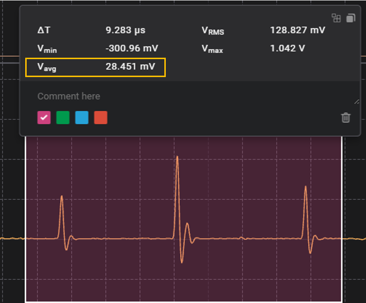
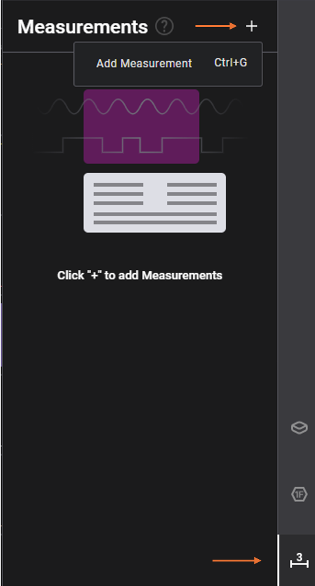

# Voltage Average

An extension that adds Voltage Average metrics to analog measurements.

## Instructions
1. Install this extension by clicking "Install"
2. Press Ctrl+G to add a measurement, or click Measurements on the right and then click the + icon.

3. Drag the measurement selection window over your recorded data.
